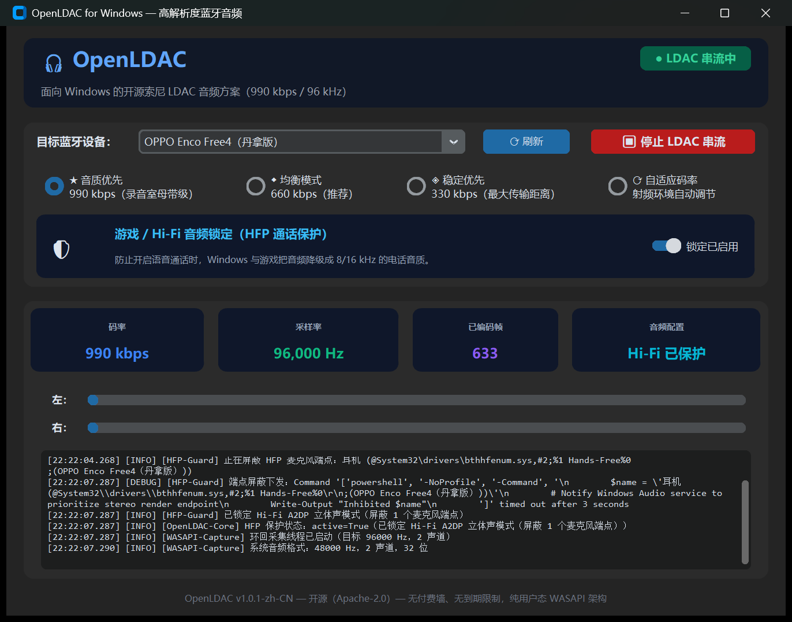

# OpenLDAC for Windows — 简体中文版

[](LICENSE)
[]()
[]()
[]()
[]()

> [!WARNING]
> **技术现状（使用前必读）**
> 本仓库是上游 [OpenLDAC-Windows v1.0.0](https://github.com/shubhamkjha369/OpenLDAC-Windows) 的简体中文分支。上游的音频链路只有前半段是真的：
>
> | 环节 | 实际状态 |
> |---|---|
> | WASAPI 环回采集 | ✅ 真实实现（本版修复了它的启动崩溃，见下） |
> | LDAC 编码 | ❌ 占位实现。`src/codec/ldac_encoder.py:182` 自注 *"MDCT equivalent simulation"*，`:205` 为 `np.clip(x * 127)`，`:207-213` 用字节重复凑满帧长；无 MDCT、无比特分配、无哈夫曼 |
> | 往蓝牙设备发送 | ❌ 不存在。`src/` 全库无 `socket` / `BTPROTO` / `.send(` / `.connect(`；`src/app.py:163` 打包函数的返回值被直接丢弃 |
> | HFP 通话保护 | ⚠️ 只检测端点并写入日志，`_inhibit_endpoint()` 下发的 PowerShell 只 `Write-Output`，并未真正禁用端点 |
>
> 结论：界面可以正常打开、点击、显示状态，但**不会把声音送进蓝牙耳机**。界面上的码率（990 / 660 / 330 kbps）是查表预设值，已编码帧数是自增计数器，不来自真实测量。
>
> 本仓库的真实价值在四个地方：**简体中文界面、高 DPI 布局修复、安装/卸载脚本修复、WASAPI 采集线程崩溃修复**。

> **这是上游 v1.0.0 的简体中文汉化分支**，界面与用户可见日志全部中文化，并额外修复了高 DPI 缩放下的界面裁切问题、安装脚本缺陷，以及一点「开始串流」就崩溃的 WASAPI 采集 bug（上游 v1.0.0 至今未修）。

---

## 📸 界面预览



界面在 150% 缩放下完整显示、无裁切；状态徽标、遥测卡片、诊断日志均为中文。

---

## 🌟 本版实际做了什么

* **🀄 全面中文界面：**
  * 标题、状态徽标、按钮、音质预设、遥测卡片、HFP 保护卡片、诊断日志、页脚全部中文化。
  * 界面与用户可见日志全部中文化（33 处），设备扫描、HFP 拦截、WASAPI 采集、编码器状态都能看懂。
  * 统一 `Microsoft YaHei UI` 字体族，中英文混排不再出现字号跳变或方框。
* **🖥️ 高 DPI 修复：**
  * 上游在 125% – 200% 缩放下，底部数据卡片与日志框会被窗口边界裁掉（控件需求高度超过窗口高度）。
  * 本版显式启用 Per-Monitor DPI 感知（`SetProcessDpiAwareness(2)`，且在创建 Tk 之前完成），消除系统位图拉伸导致的字体模糊，并收紧内边距、调整窗口尺寸，使界面在各档缩放下完整显示。
* **🧰 安装脚本修复（四处真实 bug）：**
  * 脚本以无 BOM 的 UTF-8 写出，Windows PowerShell 5.1 按 ANSI 解码 → 中文字符串被截断、直接语法错误。
  * 卸载脚本使用 here-string 拼接，触发 `The splatting operator '@' ...` 语法错误。
  * `$InstallDir = "%LOCALAPPDATA%\..."` 在 PowerShell 中不展开环境变量，会把程序装进字面量目录 `%LOCALAPPDATA%\Programs\...`。
  * 卸载 bat 先删自身所在目录，导致后续 `del` 永不执行，桌面快捷方式残留。
* **🩹 WASAPI 采集崩溃修复（v1.0.1，唯一逻辑修复）：**
  * 现象：点击「开始 LDAC 串流」后日志报 `WASAPI 采集线程异常：call takes exactly 1 arguments (6 given)`，采集回调为 0。
  * 根因：`IAudioCaptureClient.GetBuffer` 的五个参数声明为纯 `['out']`，comtypes 会把纯 out 参数从调用签名中剔除、改以返回值元组交出，签名只剩 `this`；而调用点仍按老写法传了五个 `byref(...)`。
  * 修复：改为解包返回值，即 `pData, frames_read, flags, device_pos, qpc_pos = capture_client.GetBuffer()`。
  * 验证：边播放 440 Hz 正弦边采集 3 秒 → 301 次回调 / 144,480 帧，左右声道电平正常，无异常。

---

## ⚠️ 上游设计的上限（不是本版能修的）

* **编码不是 LDAC**：上游编码器是占位实现，输出不是可解码的 LDAC 码流。要变真，只能链接索尼开源的 `libldac`（AOSP，Apache-2.0，`ldacBT_encode` / `ldacBT_decode`），而不是自己重写。
* **没有发送链路**：A2DP 媒体流走 **L2CAP PSM 25（AVDTP）**，而 Windows 不向用户态开放 L2CAP —— `socket.AF_BLUETOOTH` 存在，但 `BTPROTO_L2CAP` 不存在；`BTHPROTO_RFCOMM` 是串口仿真，载不动 AVDTP。Windows 的 A2DP 在其蓝牙栈内部完成，原生只实现 SBC（与 Windows 11 的 AAC）。
* **所以「纯用户态 + 无驱动」与「真的把 LDAC 送进耳机」在 Windows 上互斥**：要真发，必须替换或挂接 A2DP 驱动栈（签名蓝牙 profile driver），或改用硬件发射器。

如果你要的是「耳机听起来更好」，最实际的三条路：禁用耳机的 Hands-Free 端点后使用 AAC、买一个支持 LDAC 的 USB 蓝牙发射器、或使用第三方 A2DP 驱动方案（如 Alternative A2DP Driver）。

---

## 📁 仓库结构

```
OpenLDAC-Windows-zh/
├── src/
│   ├── app.py                 # 串流控制器（采集 + UI 驱动，无发送链路）
│   ├── audio/
│   │   └── wasapi_capture.py  # WASAPI 环回采集（本版修复 GetBuffer 崩溃）
│   ├── codec/
│   │   └── ldac_encoder.py    # 占位编码器（非真实 LDAC，见上文「技术现状」）
│   ├── bluetooth/
│   │   ├── avdtp_streamer.py  # RTP 头构造与计数（不含任何发送调用）
│   │   ├── device_manager.py  # 蓝牙设备发现与配置文件
│   │   └── hfp_guard.py       # HFP 端点检测（未真正禁用端点）
│   ├── gui/
│   │   └── main_window.py     # CustomTkinter 暗色主题界面（已汉化）
│   └── utils/
│       ├── config.py          # 用户设置持久化
│       └── logger.py          # 线程安全日志子系统
├── tests/                     # 自动化测试（pytest，10 项全通过）
│   ├── test_ldac_codec.py
│   ├── test_avdtp_packet.py
│   ├── test_hfp_guard.py
│   └── test_integration.py
├── installer/
│   ├── build_app.py           # PyInstaller 独立可执行文件构建脚本
│   └── create_installer.py    # 便携 zip 与安装脚本生成器
├── assets/
│   ├── icon.ico
│   ├── icon.png
│   └── screenshots/
│       └── main-window.png    # 中文界面截图
├── docs/
│   ├── ARCHITECTURE.md        # 架构说明（已译中文）
│   └── HFP_DEGRADATION_FIX.md # 蓝牙麦克风降级修复详解（已译中文）
├── CHANGELOG.md               # 版本变更记录
├── NOTICE                     # 上游版权与修改声明
└── run.py                     # 源码启动器（含 DPI 感知初始化）
```

---

## 🚀 快速开始

### 方式 1：直接下载发布版（无需 Python）

* **`OpenLDAC-zh-CN_Portable.exe`（推荐用于查看界面）：**
  * **零安装。** 单个自包含可执行文件（约 26 MB），下载后双击即用，无需 Python 或任何外部运行时。
* **`OpenLDAC-zh-CN-v1.0.1-win-x64.zip`：**
  * 完整应用目录 + 一键安装脚本（`Install_OpenLDAC_zh-CN.bat`），可安装到 `%LOCALAPPDATA%\Programs\OpenLDAC-zh-CN` 并创建桌面快捷方式。
  * 安装目录与英文版独立，可与 [上游发布版](https://github.com/shubhamkjha369/OpenLDAC-Windows/releases) 并存。

> 两个发布版都是**完整可运行的界面程序**，但如「技术现状」所述，它们不会真的把音频送进耳机。v1.0.1 相对 v1.0.0 只多修了一个 WASAPI 采集崩溃。

### 方式 2：从源码构建

```powershell
git clone https://github.com/hangyang555/OpenLDAC-Windows-zh.git
cd OpenLDAC-Windows-zh
python -m venv venv
venv\Scripts\activate
pip install -r requirements.txt

python run.py                     # 直接运行源码
python installer\build_app.py     # 打包目录版 + 单文件版到 dist\
python installer\create_installer.py   # 生成便携 zip 与安装脚本
```

需要 Python 3.11+（本版用 3.12 构建），Windows 10 1809+ / Windows 11 x64。

---

## 🧪 运行自动化测试

```powershell
pip install pytest
python -m pytest tests -v
```

共 10 项测试，校验编码器帧长与同步字、CRC 计算、RTP 包头、AVDTP 能力元素，以及 HFP 通话保护状态机（与上游同一套测试）。

**注意**：这些测试断言的是**数据结构的外形**（长度、同步字、CRC 位置），不校验码流能否被解码器还原，因此「10/10 通过」不代表 LDAC 编码可用。

---

## 💻 系统要求

* **操作系统：** Windows 10（1809+）或 Windows 11（64 位）
* **蓝牙：** 蓝牙 4.0+ 适配器（用于设备枚举与 HFP 端点检测）
* **耳机 / 接收端：** 任意蓝牙耳机均可用于查看界面；如要真正听到 LDAC，需要硬件发射器或第三方 A2DP 驱动，本程序无法提供

---

## 📝 说明

* 本版修改了四类内容：界面文案汉化、DPI 感知与布局、安装脚本、WASAPI 采集崩溃。**没有实现 LDAC 编码，也没有实现蓝牙发送**——这两项在上游原本就未实现，本版保持原状（详见上文「技术现状」与「上游设计的上限」）。
* v1.0.1 相对 v1.0.0 仅改动 5 个文件：`src/audio/wasapi_capture.py`（采集崩溃修复）、`src/__init__.py`（版本号）、`src/gui/main_window.py`（页脚版本号）、`installer/create_installer.py`（版本号与 zip 名）、`CHANGELOG.md`。
* 配置文件与原版共用 `%LOCALAPPDATA%\OpenLDAC\config.json`，切换版本不会丢失设备与音质设置。
* 版本变更记录见 [CHANGELOG.md](CHANGELOG.md)。

---

## 🙏 致谢

上游项目 [shubhamkjha369/OpenLDAC-Windows](https://github.com/shubhamkjha369/OpenLDAC-Windows)（Apache-2.0）提供了界面结构、WASAPI 采集骨架与 HFP 端点检测思路。

---

## 📄 许可证

基于 [Apache License 2.0](LICENSE) 发布，上游版权与修改声明见 [NOTICE](NOTICE)。
Sony 与 LDAC 是索尼公司的注册商标。
